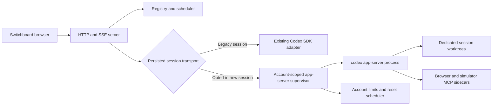

# Codex app-server parity design

**Date:** 2026-08-11

**Status:** Approved

**Scope:** Codex transport and five Claude-parity gaps in Switchboard

## Summary

Switchboard currently runs Codex through `@openai/codex-sdk` 0.145.0. That
transport supports thread lifecycle and streamed items, but it cannot provide
the interactive and account-level surfaces needed for:

1. Codex approvals and `needs-you` state.
2. Structured user questions.
3. Claude-shaped slash discovery for Codex skills, apps, and MCP tools.
4. Switchboard-injected browser and simulator screenshot tools.
5. Reliable Codex plan/rate-limit telemetry and automatic reset requeue.

These features will be implemented on Codex app-server. The rollout is staged:
new, explicitly opted-in sessions use app-server while existing SDK sessions
retain the SDK for their entire lifetime. The two transports must never own the
same vendor thread.

The design uses stable app-server APIs except for one narrowly allowlisted,
capability-gated use of the experimental `tool/requestUserInput` request. Exact
plugin marketplace discovery remains deferred because its app-server methods
are documented as under development.

## Goals

- Give Codex sessions the same visible `needs-you` and Auto behavior that Claude
  sessions have today.
- Render one app-server question at a time while responding to the complete
  request atomically.
- Keep Switchboard's Claude-shaped slash menu while translating selections into
  native Codex inputs.
- Share the existing browser and simulator screenshot implementations between
  Claude and Codex.
- Use authoritative Codex account windows and reset timestamps for display,
  scheduling, and recovery.
- Preserve the fixed Codex `workspace-write` sandbox, repository instructions,
  repository configuration, worktree isolation, and launch-secret boundaries.
- Keep `npm test` offline, deterministic, and free of paid account calls.

## Non-goals

- Interactive browser control, browser console/network inspection, or simulator
  tap/swipe/type/install/launch tools.
- Full Codex plugin marketplace browsing, installation, removal, or upgrades.
- Experimental process control, dynamic tools, background terminals, or
  additional-permissions requests.
- Exposing sandbox mode or approval policy in Switchboard settings.
- Using `thread/shellCommand`, which app-server documents as running outside the
  thread sandbox.
- Moving an existing vendor thread from SDK to app-server or vice versa.
- Automatically replaying an interrupted turn after a transport crash.
- Guessing a Codex reset time for an API-key-only or otherwise unsupported
  account.

## Selected delivery approach

Work proceeds foundation-first in independently releasable phases:

1. App-server transport, supervision, schema validation, persisted transport
   ownership, and SDK fallback for legacy sessions.
2. Approvals, `needs-you`, sequential questions, and MCP elicitation.
3. Claude-shaped capability discovery plus browser/simulator MCP sidecars.
4. Plan/rate-limit telemetry and Claude-like automatic reset requeue.
5. App-server default after live compatibility gates and a soak period.

A feature-by-feature transport bridge was rejected because it would duplicate
request correlation, lifecycle, and fallback logic. A single big-bang
replacement was rejected because it would combine transport, UI, account, and
MCP risk into one rollback boundary.

## Architecture



### Transport ownership

Add a persisted `codexTransport: "sdk" | "app-server"` field to Codex sessions.

- A restored Codex session without the field is treated as `sdk`.
- New sessions copy the selected transport from their account configuration.
- The value becomes immutable once a vendor thread ID is assigned.
- Resume dispatches exclusively through the stored transport.
- A transport setting change affects future sessions only.
- SDK and app-server never open or resume the same vendor thread.

Store the Codex runtime version used to create an app-server session for
diagnostics. It does not permit cross-transport migration.

### Account-scoped supervisor

Each opted-in Codex account gets one app-server child process. This matches the
account-scoped authentication environment and rate-limit stream while allowing
the process to multiplex several Switchboard sessions. Each app-server thread
still receives exactly one dedicated git worktree.

The supervisor owns:

- App-server initialization and capability negotiation.
- Monotonic client request IDs and a pending-resolver map.
- Server-request correlation and response delivery.
- Thread ID to Switchboard session ID routing.
- Process shutdown, bounded restart backoff, and malformed-output handling.
- Account plan and rate-limit reads/notifications.
- Redaction before events reach the Registry.
- MCP sidecar process configuration and status.

A supervisor crash stops all of its active turns with a typed transport error,
clears their pending interactions, and marks queued prompts unsent. It may
restart for future work, but it does not replay interrupted turns because a
command or file change may already have taken effect.

### Version-matched protocol contract

Switchboard is currently pinned to Codex SDK/CLI 0.145.0, while required account
and capability APIs were added later. The transport phase therefore begins by:

1. Selecting and pinning one SDK/CLI version whose generated schema includes
   every required method.
2. Generating protocol types/schema from that exact executable.
3. Checking the required stable method allowlist and the one experimental
   `tool/requestUserInput` exception.
4. Rejecting app-server preflight when the executable version does not match the
   compiled protocol contract.
5. Keeping the SDK transport operational during the rollout.

No production implementation should copy shapes from current online
documentation without first confirming them in the pinned executable's
generated schema.

## Interaction model

### Pending interaction type

Replace the approval-specific pending value with a tagged union:

```ts
type PendingInteraction =
  | CommandOrFileApproval
  | StructuredQuestions
  | McpFormElicitation
  | McpUrlElicitation;
```

Each session has a FIFO pending-interaction queue. The public session exposes
the head as `pending` plus a count of additional queued interactions. Only the
head is answerable. The session stays `needs-you` until the queue is empty.

```mermaid
stateDiagram-v2
    [*] --> working
    working --> needs_you: first interaction arrives
    needs_you --> needs_you: resolve head; more remain
    needs_you --> working: queue becomes empty
    needs_you --> stopped: user stops or transport fails
    working --> stopped: turn or transport fails
    working --> done: turn completes
```



The adapter retains connection-scoped request IDs and response callbacks. A
pending interaction is visible state, not a durable promise: after process
restart it must be cleared and cannot remain actionable.

### Command and file approvals

Codex continues to use the fixed `workspace-write` sandbox. Switchboard does
not expose sandbox or approval-policy controls.

With Auto off:

- A command or file request enters the FIFO.
- The session becomes `needs-you`.
- The card and interrupt strip show Allow once and Deny.
- Allow maps to app-server `accept`; Deny maps to `decline`.
- Session-wide acceptance, policy amendments, and experimental additional
  permissions are not exposed.

With Auto on:

- Switchboard responds `accept` to each eligible command/file request without
  showing a card.
- It deliberately does not send `acceptForSession`, so turning Auto off later
  takes effect.
- Auto cannot widen the sandbox or override disabled network access.
- Requests that require unsupported permission expansion are declined safely.

Stopping a blocked session cancels or declines every unresolved request before
interrupting the turn. App-tool approval variants delivered through
`tool/requestUserInput` normalize into the same approval card rather than the
ordinary question UI.

### Sequential structured questions

The app-server request remains atomic, but the browser presents one question at
a time:

1. Show the current question, descriptions, supported selection behavior, and
   an Other field when offered.
2. Store draft answers in an in-memory browser map keyed by request ID.
3. Permit Back and Next navigation.
4. Submit the complete answer map only from the final question.
5. Record only a neutral transcript result such as `Answered 3 questions`.

Raw answers are not written to `state.json` or copied into the transcript,
because MCP forms and questions may contain credentials or other sensitive
values. A browser refresh discards unfinished drafts and returns to question
one without cancelling the upstream request.

`serverRequest/resolved` is authoritative. The UI disables controls during
submission but does not clear `needs-you` merely because its HTTP request was
sent. A response that races an auto-resolution returns a conflict and refreshes
the card. When app-server supplies `autoResolutionMs`, the UI shows a countdown.

### Experimental boundary

`tool/requestUserInput` is the only experimental behavior enabled for this
program. It is protected by:

- Version-matched schema presence.
- Runtime capability detection.
- An app-server rollout flag.
- A strict server-request allowlist.
- A normal transcript-question fallback when unavailable.

Stable MCP form and URL elicitation use their documented methods. Unknown
server requests receive an error response so they cannot hang the child.

## Capability discovery

Codex capability discovery is account- and working-directory-scoped rather
than machine-wide. Add a lazy server endpoint keyed by account and cwd. It
returns typed, server-generated entries:

```ts
type Capability = {
  id: string;
  kind: "command" | "skill" | "app" | "mcp-tool";
  alias: string;
  displayName: string;
  description: string | null;
  available: boolean;
  unavailableReason: string | null;
};
```

The catalog uses only supported sources:

- `skills/list`
- `app/list` and `app/installed`
- `mcpServerStatus/list`
- Skill, app-list, and MCP-status notifications as invalidation signals

The result is cached by revision and fetched on demand instead of being copied
into every SSE snapshot. Existing sessions query with their worktree cwd. The
new-session dialog queries with the selected repository path until its
worktree exists.

### Claude-shaped aliases

| Visible alias | Native behavior |
| --- | --- |
| `/skill:name` | Send `$name` plus a server-resolved structured `skill` input. |
| `/app:name` | Send `$name` plus a server-resolved `mention` with its `app://` ID. |
| `/mcp:server.tool` | Expand to an explicit instruction to use that configured MCP tool. |
| `/compact` | Call `thread/compact/start` without starting a model turn. |
| `/skills`, `/apps`, `/mcp` | Open a filtered local capability list. |

The transcript preserves the slash-shaped text entered by the user while the
adapter sends native Codex input. Namespaced aliases avoid collisions. A bare
suffix may resolve only when it matches exactly one available capability.

All alias resolution happens on the server at send time. Browser-supplied
paths, app IDs, server names, and tool names are never trusted directly.
Unavailable apps and MCP servers remain visible but disabled with an auth or
startup explanation.

### Plugin boundary

Exact plugin marketplace discovery, reads, installation, and removal are
excluded while app-server documents those APIs as under development. Installed
plugin-provided skills and apps still appear through the stable skill and app
APIs. Stable provenance may be displayed, but Switchboard does not claim to be
a complete Codex plugin manager in this release.

## Browser and simulator MCP injection

Refactor the existing screenshot implementations into shared handlers used by:

- The current Claude in-process SDK MCP wrappers.
- New stable stdio MCP entrypoints for app-server.

The Codex server/tool names are:

- `switchboard_browser.screenshot`
- `switchboard_simulator.screenshot`

Switchboard passes their fixed absolute Node and entrypoint paths through
ephemeral app-server process configuration. It does not create or modify
`.codex/config.toml` or any repository file. User and repository Codex
configuration remain intact.

Injection rules:

- Browser is advertised only when supported Chromium is installed and the
  thread's effective network policy permits it.
- Browser retains HTTP/HTTPS-only URL validation, throwaway profiles, capture
  timeout, and isolation from user cookies.
- Simulator is advertised only on macOS and retains device-name validation and
  bounded screenshot capture.
- A reserved-name collision is a visible preflight warning, never an overwrite.
- Sidecar failure removes only that capability and does not block ordinary
  Codex work.
- Sidecars receive no account secrets beyond the minimum environment required
  to launch Node.

The scope is screenshot parity only. Interactive browser and simulator control
requires a separate design.

## Plan and rate-limit telemetry

Generalize the account-limit model so it no longer assumes fixed Claude window
names:

```ts
type AccountLimitSnapshot = {
  plan: string | null;
  windows: {
    id: string;
    label: string;
    usedPercent: number;
    windowDurationMins: number;
    resetsAt: number;
    reached: boolean;
  }[];
  fetchedAt: number;
  authoritative: boolean;
};
```

Claude's current five-hour and seven-day limits normalize into this shape.
Codex uses:

- `account/read` and `account/updated` for plan type.
- `account/rateLimits/read` for initial state and reconciliation.
- `account/rateLimits/updated` for live changes.
- `codexErrorInfo: UsageLimitExceeded` for typed turn failure.

The badge headlines the shortest applicable window. The expanded account panel
shows every window and local reset time. Account ranking continues to use the
highest reported utilization so a nearly exhausted long window cannot be
hidden by a quiet short one.

Snapshots are not persisted. Refresh them:

- At supervisor initialization.
- Every five minutes.
- After relevant account notifications.
- After `UsageLimitExceeded`.
- Immediately before releasing reset-queued work.

Local token pace remains a labeled ranking estimate. It is not authoritative
enough to release Codex reset work.

### Authoritative reset eligibility

A Codex account is eligible for reset scheduling only when:

- Its authentication mode supports ChatGPT account limits.
- A successful authoritative read occurred during the current process lifetime.
- At least one reached window supplies a future reset timestamp.

API-key-only and unsupported accounts continue showing an estimate but require
manual resume. Their `When usage resets` option is disabled with an explanation.
After restart, restored reset items remain waiting until the first authoritative
refresh succeeds; a persisted timestamp cannot release work by itself.

### Automatic recovery

When a Codex turn fails with `UsageLimitExceeded`:

1. Stop it with typed code `codex_usage_limited`.
2. Refresh the account's limits immediately.
3. Compute the blocking time from every reached window. When multiple windows
   block work, use the latest required reset.
4. If Auto requeue is enabled, enqueue exactly one visible resume with prompt
   `continue`.
5. Render the existing `waiting for reset` treatment used by Claude.
6. Follow later reset updates without duplicating or prematurely releasing the
   item.
7. At the boundary, refresh limits again.
8. Release only when fresh provider state reports capacity.

Preserve current scheduler behavior:

- At most one reset-triggered item per account starts per scheduler pass.
- Busy accounts do not start a second reset item.
- User Stop never queues a resume.
- Deleting the queue item does not recreate it.
- Enabling Auto requeue later is not retroactive.
- Limit notifications do not interrupt a successful active turn.
- Duplicate failure/completion notifications cannot duplicate a resume.

If the failure precedes its matching account notification, hold the requeue
decision through the immediate limits read. If that read fails or yields no
reset, leave the session manually resumable rather than matching error text or
using a local estimate.

App-server `turn/plan/updated` also normalizes into Switchboard's existing plan
or todo transcript item, with the final update authoritative.

## Errors and safety

Extend the typed Codex failure set to distinguish:

- App-server unavailable.
- Executable/protocol version mismatch.
- App-server initialization or authentication failure.
- Transport crash or malformed protocol output.
- App-server request timeout.
- Usage limit reached.
- User interruption.

Rules:

- New app-server work fails clearly when preflight fails; it never silently
  creates an SDK-owned session.
- A crash clears actionable interactions and never leaves stale approval UI.
- Client request timeouts fail the affected operation; protocol corruption
  terminates and restarts the supervisor rather than continuing desynchronized.
- Sidecar errors and account telemetry errors remain nonfatal.
- Unknown notifications are ignored safely; unknown server requests are
  rejected explicitly.
- Account environment values, raw child stderr, prompts, question answers, and
  MCP form values do not enter diagnostics or telemetry.
- Existing Codex redaction remains in front of Registry persistence and SSE.

## Verification strategy

`npm test` remains offline and uses the fake Codex executable, temporary
`CODEX_HOME`, and local temporary files.

### Protocol fixtures

- Validate every required request, response, notification, and error variant
  against the pinned generated contract.
- Prove unsupported experimental methods are excluded.
- Prove `tool/requestUserInput` disappears cleanly when capability-gated off.

### Fake app-server process

Drive the real stdio boundary with fixtures covering:

- Concurrent and out-of-order client responses.
- Multiple sessions on one account supervisor.
- New turn, follow-up, resume, interrupt, and clean shutdown.
- Command/file approvals and FIFO behavior.
- Sequential questions, MCP form/URL elicitation, and automatic resolution.
- Plan and multi-window account updates.
- Crashes, malformed JSON, request timeouts, and restart backoff.
- Secret redaction and bounded stderr handling.

### Server and Registry tests

- Legacy transport migration and immutable ownership.
- Pending-interaction and `needs-you` transitions.
- Auto, deny, stop, and stale-decision behavior.
- Capability cache invalidation and server-side alias resolution.
- Authoritative-reset freshness and duplicate requeue prevention.
- Scheduler persistence and restart behavior.

### UI tests

- Approval cards and cross-session interrupt strip.
- Sequential question Back/Next/Submit behavior.
- Countdown and late-response conflict behavior.
- Namespaced slash matching and native expansion.
- Disabled capability explanations.
- Codex plan/window rendering and queued reset treatment.

### Opt-in live smoke suite

Keep real-account checks outside `npm test`. The production cutover gate covers:

- Real initialization, authentication read, plan read, and clean shutdown.
- New turn, follow-up, process restart, and resume.
- Command and file approval round trips.
- Guarded `tool/requestUserInput` round trip.
- Local browser screenshot through the injected MCP server.
- Simulator screenshot when a device is available.
- Legacy SDK session resume after the dependency upgrade.

`UsageLimitExceeded` is tested deterministically through the fake boundary; the
live suite must not intentionally exhaust an account.

## Rollout and rollback

The Codex account configuration gains an explicit transport selection.

1. Initial default remains SDK.
2. Opted-in accounts use app-server for new sessions.
3. After live gates and a soak period, app-server becomes the new-session
   default while an explicit SDK override remains.
4. Existing sessions retain their persisted transport.
5. Rollback changes future sessions only.
6. SDK removal requires zero remaining SDK sessions and a separate cleanup
   decision.

An existing app-server session may be resumed with app-server or abandoned. It
must never be reopened through the SDK.

Operational counters may cover starts, crashes, protocol mismatches,
pending-request latency, and requeue outcomes. They must not contain prompts,
answers, environment values, or account identifiers beyond the configured
display name.

## Acceptance criteria

The program is complete when all of the following are true:

- Real Codex command/file approvals drive `needs-you`, Allow, and Deny.
- Auto matches the current Claude session behavior without granting irreversible
  session-wide approval.
- A 1-3 question request renders sequentially and responds atomically.
- Unsupported question capability falls back without hanging a turn.
- Codex skills, apps, and MCP tools appear in the Claude-shaped slash menu and
  resolve on the server.
- Installed plugin-provided capabilities appear through supported APIs without
  using the under-development plugin catalog.
- Browser and simulator screenshots work through injected stdio MCP without
  modifying repository configuration.
- Codex plan and every reported limit window render from authoritative data.
- `UsageLimitExceeded` creates one Claude-like reset resume and releases it only
  after a fresh provider check.
- Legacy SDK sessions remain resumable throughout rollout.
- The complete offline suite and opt-in live compatibility matrix pass.

## References

- [Codex app-server](https://developers.openai.com/codex/app-server/)
- [Codex SDK](https://developers.openai.com/codex/sdk/)
- [Codex MCP](https://developers.openai.com/codex/mcp/)
- `docs/superpowers/reports/2026-08-01-codex-phase-2-compatibility.md`
- `docs/superpowers/reports/2026-08-01-codex-app-server-decision.md`
