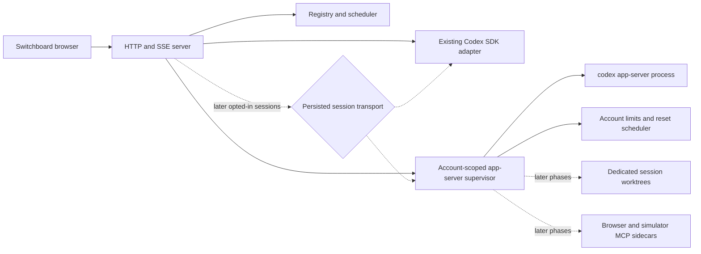

# Codex app-server parity design

**Date:** 2026-08-11; revised 2026-08-26

**Status:** Revised — awaiting review

**Scope:** A reusable Codex app-server foundation, usage telemetry as its first
release, and five later Claude-parity gaps in Switchboard

## Summary

Switchboard currently runs Codex turns through `@openai/codex-sdk` 0.145.0.
That transport supports thread lifecycle and streamed items, but it cannot
provide the interactive and account-level surfaces needed for:

1. Codex approvals and `needs-you` state.
2. Structured user questions.
3. Claude-shaped slash discovery for Codex skills, apps, and MCP tools.
4. Switchboard-injected browser and simulator screenshot tools.
5. Reliable Codex plan/rate-limit telemetry and automatic reset requeue.

These features will be implemented on Codex app-server, but account telemetry
lands first. The first release creates one reusable, account-scoped app-server
supervisor per Codex account and uses it only to read plan and rate-limit data.
All Codex threads and turns remain SDK-owned during that release. Later phases
extend the same supervisor to opted-in new app-server sessions, interactions,
capabilities, tools, and typed usage-limit recovery. Existing SDK sessions
retain the SDK for their entire lifetime, and the two transports never own the
same vendor thread.

The design uses stable app-server APIs except for one narrowly allowlisted,
capability-gated use of the experimental `tool/requestUserInput` request. Exact
plugin marketplace discovery remains deferred because its app-server methods
are documented as under development.

## Goals

- Ship authoritative Codex usage windows, including the normally reported
  five-hour window, before migrating any Codex turn transport.
- Make that first release the durable app-server account/process foundation for
  later work rather than a disposable polling probe.
- Use authoritative Codex reset timestamps for manual reset scheduling from the
  first release, with a fresh provider check before queued work is released.
- Give Codex sessions the same visible `needs-you` and Auto behavior that Claude
  sessions have today in a later interaction phase.
- Render one app-server question at a time while responding to the complete
  request atomically.
- Keep Switchboard's Claude-shaped slash menu while translating selections into
  native Codex inputs.
- Share the existing browser and simulator screenshot implementations between
  Claude and Codex.
- Add exact automatic recovery only after app-server owns the affected turn and
  reports typed `UsageLimitExceeded` data.
- Preserve the fixed Codex `workspace-write` sandbox, repository instructions,
  repository configuration, worktree isolation, and launch-secret boundaries.
- Keep `npm test` offline, deterministic, and free of paid account calls.

## Non-goals

- Interactive browser control, browser console/network inspection, or simulator
  tap/swipe/type/install/launch tools.
- Full Codex plugin marketplace browsing, installation, removal, or upgrades.
- Experimental process control, dynamic tools, background terminals, or
  additional-permissions requests.
- Exposing sandbox mode or approval policy in Switchboard settings.
- Using `thread/shellCommand`, which app-server documents as running outside the
  thread sandbox.
- Moving an existing vendor thread from SDK to app-server or vice versa.
- Automatically replaying an interrupted turn after a transport crash.
- Guessing a Codex reset time for an API-key-only or otherwise unsupported
  account.
- Inferring `UsageLimitExceeded` from SDK error text, or from the coincidence of
  an SDK failure and an exhausted account window.
- Automatically requeueing a failed SDK-owned Codex turn. Exact recovery waits
  for the later app-server turn-transport phase.

## Selected delivery approach

Work proceeds foundation-first in independently releasable phases:

1. Account-scoped app-server supervision, version-matched schema validation,
   authoritative plan/rate-limit telemetry, provider-neutral meters and
   ranking, and fresh reset-aware manual scheduling. No app-server thread or
   turn is created; every Codex session remains SDK-owned.
2. App-server thread transport for explicitly opted-in new sessions, persisted
   transport ownership, and SDK fallback for legacy sessions.
3. Approvals, `needs-you`, sequential questions, and MCP elicitation.
4. Claude-shaped capability discovery plus browser/simulator MCP sidecars.
5. Typed `UsageLimitExceeded` recovery for app-server-owned turns, followed by
   the app-server new-session default only after live compatibility gates and a
   soak period.

The first phase is not a second, throwaway app-server client. It establishes the
same request correlation, process supervision, generated contract, and account
ownership that later phases extend. A short-lived process spawned every five
minutes was rejected because it would discard notification support and require
process-lifecycle work to be replaced later. A single big-bang replacement was
rejected because it would delay the requested usage meter and combine
transport, UI, account, and MCP risk into one rollback boundary.

The existing `2026-08-11-codex-*.md` implementation plans predate this revised
ordering. They must be replaced or revised before execution; their old
foundation-first-then-limits dependency order is not authorization to defer the
telemetry-first release described here.

## Architecture



### Transport ownership

The telemetry-first release adds no session transport field: every Codex session
continues to use the SDK. The app-server process owns account telemetry only and
must not start, resume, read, or interrupt a vendor thread.

When the later turn-transport phase begins, add a persisted
`codexTransport: "sdk" | "app-server"` field to Codex sessions.

- A restored Codex session without the field is treated as `sdk`.
- New sessions copy the selected transport from their account configuration.
- The value becomes immutable once a vendor thread ID is assigned.
- Resume dispatches exclusively through the stored transport.
- A transport setting change affects future sessions only.
- SDK and app-server never open or resume the same vendor thread.

Store the Codex runtime version used to create an app-server session for
diagnostics. It does not permit cross-transport migration.

### Account-scoped supervisor

Each Codex account gets one app-server child process after telemetry preflight
succeeds. This matches the account-scoped authentication environment and
rate-limit stream. In the first release the process is long-lived only for
account telemetry; it owns no threads and receives no worktree. Later it may
multiplex opted-in app-server sessions, each of which still receives exactly one
dedicated git worktree.

The supervisor owns:

- App-server initialization and capability negotiation.
- Monotonic client request IDs and a pending-resolver map.
- Process shutdown, bounded restart backoff, and malformed-output handling.
- Account plan and rate-limit reads/notifications.
- Redaction before events reach the Registry.
- Coalesced explicit reads and five-minute reconciliation.

Later phases add server-request correlation, thread-to-session routing, and MCP
sidecar configuration to this same supervisor. They do not introduce another
app-server process owner.

During the telemetry-first release, a supervisor crash marks its account
snapshot stale, reports a sanitized soft error, and leaves SDK sessions
untouched. Once the supervisor owns turns, a crash additionally stops its
active turns with a typed transport error, clears pending interactions, and
marks queued prompts unsent. It may restart for future work, but it never
replays an interrupted turn because a command or file change may already have
taken effect.

The telemetry process uses a phase-specific method allowlist and does not enable
experimental capabilities, inject MCP sidecars, or issue thread/turn methods.
It always starts with process-local, version-matched overrides that disable MCP
servers and lifecycle hooks for that child without writing `.codex/config.toml`
or changing the user's configuration. If the pinned executable cannot guarantee
that side-effect-free startup, telemetry preflight fails and the account keeps
the local estimate.

### Version-matched protocol contract

Switchboard is currently pinned to Codex SDK/CLI 0.145.0. A generated schema
from the installed executable contains the account rate-limit methods required
for the first release. Each phase nevertheless treats its exact generated
schema as authoritative and begins by:

1. Selecting and pinning one SDK/CLI version whose generated schema includes
   that phase's required methods.
2. Generating protocol types/schema from that exact executable.
3. For phase one, allowing only initialization, `account/read`,
   `account/rateLimits/read`, `account/updated`, and
   `account/rateLimits/updated`.
4. Expanding the allowlist only when a later phase begins. The experimental
   `tool/requestUserInput` exception remains capability-gated to the interaction
   phase.
5. Rejecting app-server preflight when the executable version does not match the
   compiled protocol contract.
6. Keeping the SDK transport operational throughout the rollout.

No production implementation should copy shapes from current online
documentation without first confirming them in the pinned executable's
generated schema.

## Interaction model

### Pending interaction type

Replace the approval-specific pending value with a tagged union:

```ts
type PendingInteraction =
  | CommandOrFileApproval
  | StructuredQuestions
  | McpFormElicitation
  | McpUrlElicitation;
```

Each session has a FIFO pending-interaction queue. The public session exposes
the head as `pending` plus a count of additional queued interactions. Only the
head is answerable. The session stays `needs-you` until the queue is empty.

```mermaid
stateDiagram-v2
    [*] --> working
    working --> needs_you: first interaction arrives
    needs_you --> needs_you: resolve head; more remain
    needs_you --> working: queue becomes empty
    needs_you --> stopped: user stops or transport fails
    working --> stopped: turn or transport fails
    working --> done: turn completes
```



The adapter retains connection-scoped request IDs and response callbacks. A
pending interaction is visible state, not a durable promise: after process
restart it must be cleared and cannot remain actionable.

### Command and file approvals

Codex continues to use the fixed `workspace-write` sandbox. Switchboard does
not expose sandbox or approval-policy controls.

With Auto off:

- A command or file request enters the FIFO.
- The session becomes `needs-you`.
- The card and interrupt strip show Allow once and Deny.
- Allow maps to app-server `accept`; Deny maps to `decline`.
- Session-wide acceptance, policy amendments, and experimental additional
  permissions are not exposed.

With Auto on:

- Switchboard responds `accept` to each eligible command/file request without
  showing a card.
- It deliberately does not send `acceptForSession`, so turning Auto off later
  takes effect.
- Auto cannot widen the sandbox or override disabled network access.
- Requests that require unsupported permission expansion are declined safely.

Stopping a blocked session cancels or declines every unresolved request before
interrupting the turn. App-tool approval variants delivered through
`tool/requestUserInput` normalize into the same approval card rather than the
ordinary question UI.

### Sequential structured questions

The app-server request remains atomic, but the browser presents one question at
a time:

1. Show the current question, descriptions, supported selection behavior, and
   an Other field when offered.
2. Store draft answers in an in-memory browser map keyed by request ID.
3. Permit Back and Next navigation.
4. Submit the complete answer map only from the final question.
5. Record only a neutral transcript result such as `Answered 3 questions`.

Raw answers are not written to `state.json` or copied into the transcript,
because MCP forms and questions may contain credentials or other sensitive
values. A browser refresh discards unfinished drafts and returns to question
one without cancelling the upstream request.

`serverRequest/resolved` is authoritative. The UI disables controls during
submission but does not clear `needs-you` merely because its HTTP request was
sent. A response that races an auto-resolution returns a conflict and refreshes
the card. When app-server supplies `autoResolutionMs`, the UI shows a countdown.

### Experimental boundary

`tool/requestUserInput` is the only experimental behavior enabled for this
program. It is protected by:

- Version-matched schema presence.
- Runtime capability detection.
- An app-server rollout flag.
- A strict server-request allowlist.
- A normal transcript-question fallback when unavailable.

Stable MCP form and URL elicitation use their documented methods. Unknown
server requests receive an error response so they cannot hang the child.

## Capability discovery

Codex capability discovery is account- and working-directory-scoped rather
than machine-wide. Add a lazy server endpoint keyed by account and cwd. It
returns typed, server-generated entries:

```ts
type Capability = {
  id: string;
  kind: "command" | "skill" | "app" | "mcp-tool";
  alias: string;
  displayName: string;
  description: string | null;
  available: boolean;
  unavailableReason: string | null;
};
```

The catalog uses only supported sources:

- `skills/list`
- `app/list` and `app/installed`
- `mcpServerStatus/list`
- Skill, app-list, and MCP-status notifications as invalidation signals

The result is cached by revision and fetched on demand instead of being copied
into every SSE snapshot. Existing sessions query with their worktree cwd. The
new-session dialog queries with the selected repository path until its
worktree exists.

### Claude-shaped aliases

| Visible alias | Native behavior |
| --- | --- |
| `/skill:name` | Send `$name` plus a server-resolved structured `skill` input. |
| `/app:name` | Send `$name` plus a server-resolved `mention` with its `app://` ID. |
| `/mcp:server.tool` | Expand to an explicit instruction to use that configured MCP tool. |
| `/compact` | Call `thread/compact/start` without starting a model turn. |
| `/skills`, `/apps`, `/mcp` | Open a filtered local capability list. |

The transcript preserves the slash-shaped text entered by the user while the
adapter sends native Codex input. Namespaced aliases avoid collisions. A bare
suffix may resolve only when it matches exactly one available capability.

All alias resolution happens on the server at send time. Browser-supplied
paths, app IDs, server names, and tool names are never trusted directly.
Unavailable apps and MCP servers remain visible but disabled with an auth or
startup explanation.

### Plugin boundary

Exact plugin marketplace discovery, reads, installation, and removal are
excluded while app-server documents those APIs as under development. Installed
plugin-provided skills and apps still appear through the stable skill and app
APIs. Stable provenance may be displayed, but Switchboard does not claim to be
a complete Codex plugin manager in this release.

## Browser and simulator MCP injection

Refactor the existing screenshot implementations into shared handlers used by:

- The current Claude in-process SDK MCP wrappers.
- New stable stdio MCP entrypoints for app-server.

The Codex server/tool names are:

- `switchboard_browser.screenshot`
- `switchboard_simulator.screenshot`

Switchboard passes their fixed absolute Node and entrypoint paths through
ephemeral app-server process configuration. It does not create or modify
`.codex/config.toml` or any repository file. User and repository Codex
configuration remain intact.

Injection rules:

- Browser is advertised only when supported Chromium is installed and the
  thread's effective network policy permits it.
- Browser retains HTTP/HTTPS-only URL validation, throwaway profiles, capture
  timeout, and isolation from user cookies.
- Simulator is advertised only on macOS and retains device-name validation and
  bounded screenshot capture.
- A reserved-name collision is a visible preflight warning, never an overwrite.
- Sidecar failure removes only that capability and does not block ordinary
  Codex work.
- Sidecars receive no account secrets beyond the minimum environment required
  to launch Node.

The scope is screenshot parity only. Interactive browser and simulator control
requires a separate design.

## Plan and rate-limit telemetry

This is the first user-visible app-server feature. Generalize the account-limit
model so it no longer assumes fixed Claude window names:

```ts
type AccountLimitSnapshot = {
  plan: string | null;
  windows: {
    id: string;
    label: string;
    usedPercent: number;
    windowDurationMins: number;
    resetsAt: number;
    reached: boolean;
  }[];
  fetchedAt: number;
  authoritative: boolean;
};
```

Claude's current five-hour and seven-day limits normalize into this shape.
Codex uses:

- `account/read` and `account/updated` for plan type.
- `account/rateLimits/read` for initial state and reconciliation.
- `account/rateLimits/updated` for live changes.

The first release does not consume thread or turn events. A later app-server
turn-transport phase additionally uses `codexErrorInfo: UsageLimitExceeded` for
typed turn failure.

The badge headlines the shortest applicable window, normally the five-hour
window. It never assumes that Codex will always report fixed 5h/7d names; the
provider's duration and label remain authoritative. The expanded account panel
shows every window and local reset time. Account ranking uses the highest
reported utilization so a nearly exhausted long window cannot be hidden by a
quiet short one.

Snapshots are not persisted. Refresh them:

- At supervisor initialization.
- Every five minutes.
- After relevant account notifications.
- Immediately before releasing reset-queued work.
- In the later recovery phase, after `UsageLimitExceeded`.

Only one read may be in flight per account. Concurrent startup, timer,
notification, scheduler-boundary, and later recovery requests coalesce behind
that read. A successful full read replaces the snapshot atomically; a partial
notification merges only schema-defined fields into the latest full snapshot
and triggers reconciliation when it cannot be applied safely.

Local token pace remains a labeled ranking estimate. It is not authoritative
enough to release Codex reset work.

If a refresh fails after a prior success, keep the last provider snapshot only
as visibly stale diagnostic data in the expanded account panel and mark it
non-authoritative. The headline meter and account ranking fall back to local
pace. Stale data cannot enable reset scheduling or release work. If no successful
snapshot exists in the current process, the existing local estimate remains the
only meter and the account panel displays a sanitized explanation.

### Authoritative reset eligibility

A Codex account is eligible for reset scheduling only when:

- Its authentication mode supports ChatGPT account limits.
- A successful authoritative read occurred during the current process lifetime.
- At least one reached window supplies a future reset timestamp.

API-key-only and unsupported accounts continue showing an estimate but require
manual resume. Their `When usage resets` option is disabled with an explanation.
After restart, restored reset items remain waiting until the first authoritative
refresh succeeds; a persisted timestamp cannot release work by itself.

This eligibility applies when creating a `When usage resets` item in the first
release. Existing or restored items are reconsidered after the supervisor's
first successful current-process read. At the expected boundary, Switchboard
performs another fresh limits read. It releases the item only when every
blocking window reports capacity; if the read fails, remains reached, or moves
the reset later, the item stays queued. No local pace threshold can override
provider state.

### Automatic recovery after app-server turn adoption

Automatic failure recovery is intentionally not part of the telemetry-first
release. The SDK exposes only an error message for a failed turn, so attributing
that failure to account exhaustion would require matching text or assuming that
an unrelated failure was usage-caused merely because a window was reached.
Neither inference is allowed.

After app-server owns an opted-in turn and reports typed `UsageLimitExceeded`:

1. Stop it with typed code `codex_usage_limited`.
2. Refresh the account's limits immediately.
3. Compute the blocking time from every reached window. When multiple windows
   block work, use the latest required reset.
4. If Auto requeue is enabled, enqueue exactly one visible resume with prompt
   `continue`.
5. Render the existing `waiting for reset` treatment used by Claude.
6. Follow later reset updates without duplicating or prematurely releasing the
   item.
7. At the boundary, refresh limits again.
8. Release only when fresh provider state reports capacity.

Preserve current scheduler behavior:

- At most one reset-triggered item per account starts per scheduler pass.
- Busy accounts do not start a second reset item.
- User Stop never queues a resume.
- Deleting the queue item does not recreate it.
- Enabling Auto requeue later is not retroactive.
- Limit notifications do not interrupt a successful active turn.
- Duplicate failure/completion notifications cannot duplicate a resume.

If the failure precedes its matching account notification, hold the requeue
decision through the immediate limits read. If that read fails or yields no
reset, leave the session manually resumable rather than matching error text or
using a local estimate.

App-server `turn/plan/updated` also normalizes into Switchboard's existing plan
or todo transcript item, with the final update authoritative.

## Errors and safety

Extend the typed Codex failure set to distinguish:

- App-server unavailable.
- Executable/protocol version mismatch.
- App-server initialization or authentication failure.
- Transport crash or malformed protocol output.
- App-server request timeout.
- Usage limit reached.
- User interruption.

Rules:

- Telemetry preflight/read failure is soft: keep SDK sessions startable, use the
  labeled estimate, and show only a sanitized account-panel explanation.
- A telemetry-only supervisor crash cannot stop, mutate, or requeue an SDK-owned
  session.
- Once app-server session transport is selectable, new app-server work fails
  clearly when preflight fails; it never silently creates an SDK-owned session.
- A crash clears actionable interactions and never leaves stale approval UI.
- Client request timeouts fail the affected operation; protocol corruption
  terminates and restarts the supervisor rather than continuing desynchronized.
- Sidecar errors and account telemetry errors remain nonfatal.
- Unknown notifications are ignored safely; unknown server requests are
  rejected explicitly.
- Account environment values, raw child stderr, prompts, question answers, and
  MCP form values do not enter diagnostics or telemetry.
- Existing Codex redaction remains in front of Registry persistence and SSE.

## Verification strategy

`npm test` remains offline and uses the fake Codex executable, temporary
`CODEX_HOME`, and local temporary files.

### Telemetry-first release gate

Before any app-server thread transport exists, prove through the real stdio
boundary and fake process that:

- The generated contract contains the phase-one account request and notification
  allowlist.
- Initialization, account reads, rate-limit reads/updates, reconciliation,
  coalescing, timeout, crash, restart, and clean shutdown behave deterministically.
- The telemetry client never issues `thread/*`, `turn/*`, approval, question,
  capability, MCP, or experimental requests.
- Startup does not run repository hooks, start injected sidecars, modify user or
  repository configuration, or expose account environment values.
- Multi-window normalization, the shortest-window headline, worst-window
  ranking, stale fallback, and local reset rendering are correct.
- Manual reset items require current-process authoritative state and a fresh
  boundary read before release.
- An SDK turn failure never creates an automatic reset resume.

### Protocol fixtures

- Validate every required request, response, notification, and error variant
  against the pinned generated contract.
- Prove unsupported experimental methods are excluded.
- Prove `tool/requestUserInput` disappears cleanly when capability-gated off.

### Fake app-server process

Drive the real stdio boundary with fixtures covering:

- Concurrent and out-of-order client responses.
- Account telemetry with no thread or turn in the first release.
- Multiple sessions on one account supervisor after turn transport lands.
- New turn, follow-up, resume, interrupt, and clean shutdown.
- Command/file approvals and FIFO behavior.
- Sequential questions, MCP form/URL elicitation, and automatic resolution.
- Plan and multi-window account updates.
- Crashes, malformed JSON, request timeouts, and restart backoff.
- Secret redaction and bounded stderr handling.

### Server and Registry tests

- Legacy transport migration and immutable ownership.
- Pending-interaction and `needs-you` transitions.
- Auto, deny, stop, and stale-decision behavior.
- Capability cache invalidation and server-side alias resolution.
- Authoritative-reset freshness and duplicate requeue prevention.
- Scheduler persistence and restart behavior.

### UI tests

- Approval cards and cross-session interrupt strip.
- Sequential question Back/Next/Submit behavior.
- Countdown and late-response conflict behavior.
- Namespaced slash matching and native expansion.
- Disabled capability explanations.
- Codex plan/window rendering and queued reset treatment.

### Opt-in live smoke suite

Keep real-account checks outside `npm test`. The telemetry-first live gate is
no-turn and covers real initialization, authentication read, plan/rate-limit
read, notification compatibility when naturally observed, and clean shutdown.
It must not create a thread, start a turn, refresh authentication explicitly,
or intentionally consume usage.

The later production transport cutover gate additionally covers:

- New turn, follow-up, process restart, and resume.
- Command and file approval round trips.
- Guarded `tool/requestUserInput` round trip.
- Local browser screenshot through the injected MCP server.
- Simulator screenshot when a device is available.
- Legacy SDK session resume after the dependency upgrade.

`UsageLimitExceeded` is tested deterministically through the fake boundary; the
live suite must not intentionally exhaust an account.

## Rollout and rollback

Rollout has separate telemetry and transport gates:

1. Initial default remains SDK for every Codex session.
2. Pass the offline and opt-in no-turn telemetry gates, then enable the
   account-scoped supervisor for Codex accounts. Supported ChatGPT-backed
   accounts show authoritative limits; unsupported or failed accounts keep the
   existing estimate. No session transport setting exists yet.
3. Soak telemetry independently. Rollback stops the supervisors and restores
   estimate-only display without touching sessions or state.
4. A later phase adds explicit transport selection. Opted-in accounts use
   app-server only for new sessions; existing sessions retain their persisted
   transport.
5. After the full live gate and a separate turn-transport soak, app-server
   becomes the new-session default while an explicit SDK override remains.
6. Transport rollback changes future sessions only.
7. SDK removal requires zero remaining SDK sessions and a separate cleanup
   decision.

An existing app-server session may be resumed with app-server or abandoned. It
must never be reopened through the SDK.

Operational counters may cover starts, crashes, protocol mismatches,
pending-request latency, and requeue outcomes. They must not contain prompts,
answers, environment values, or account identifiers beyond the configured
display name.

## Acceptance criteria

The telemetry-first release is complete when all of the following are true:

- The account-scoped app-server supervisor remains alive for telemetry and is
  the process/request foundation later phases will extend.
- Every Codex thread and turn remains SDK-owned, and the supervisor issues no
  thread or turn request.
- A supported Codex account displays authoritative plan data and every reported
  limit window; the badge normally shows the five-hour window when present.
- Account ranking uses the most exhausted authoritative window.
- Failed, stale, logged-out, and unsupported telemetry falls back safely to a
  clearly labeled estimate.
- `When usage resets` is enabled only from fresh authoritative state and releases
  work only after a successful boundary refresh reports capacity.
- SDK turn failures never trigger inferred automatic recovery.
- No provider snapshot, credential, account environment value, raw stderr, or
  absolute attachment path is persisted or exposed.
- The complete offline suite and opt-in no-turn telemetry smoke pass.

The full parity program is complete when all of the following are true:

- Real Codex command/file approvals drive `needs-you`, Allow, and Deny.
- Auto matches the current Claude session behavior without granting irreversible
  session-wide approval.
- A 1-3 question request renders sequentially and responds atomically.
- Unsupported question capability falls back without hanging a turn.
- Codex skills, apps, and MCP tools appear in the Claude-shaped slash menu and
  resolve on the server.
- Installed plugin-provided capabilities appear through supported APIs without
  using the under-development plugin catalog.
- Browser and simulator screenshots work through injected stdio MCP without
  modifying repository configuration.
- Codex plan and every reported limit window render from authoritative data.
- `UsageLimitExceeded` creates one Claude-like reset resume and releases it only
  after a fresh provider check.
- Legacy SDK sessions remain resumable throughout rollout.
- The complete offline suite and opt-in live compatibility matrix pass.

## References

- [Codex app-server](https://developers.openai.com/codex/app-server/)
- [Codex SDK](https://developers.openai.com/codex/sdk/)
- [Codex MCP](https://developers.openai.com/codex/mcp/)
- `docs/superpowers/reports/2026-08-01-codex-phase-2-compatibility.md`
- `docs/superpowers/reports/2026-08-01-codex-app-server-decision.md`
